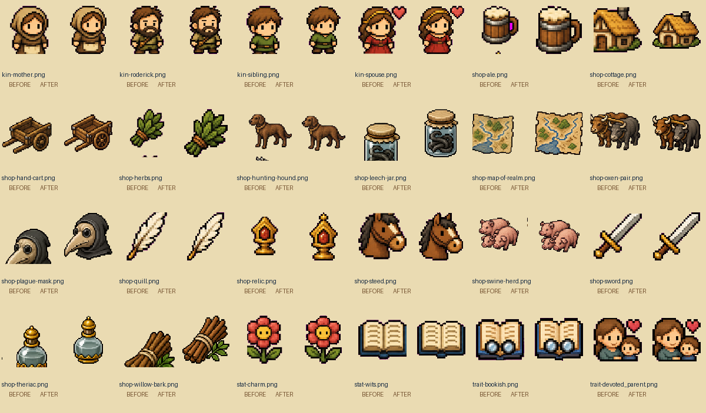

# Game icon crop review

4 November 2026 · branch `v5` · baseline `c9cadaf18b04db44f82675a5cc98f6539b16bdb3`.

Reviewed all **187 unique registered game icons**. Corrected **68 PNG assets**; the other 119 icon files remain byte-for-byte unchanged. Six larger illustrations and both configured launcher icons were also reviewed and retain their existing full-bleed compositions. The icon fixes preserve existing icon mappings, navigation, fonts, panels, buttons and game logic. The concurrent upstream Expo 58 upgrade is also preserved, as described below.

## What was wrong

The generated source sheets do not line up with equal grid cells. The old slicer cut off parts of mugs, table edges, helmets, feet, horse ears, sword tips and other outlines. Some already-trimmed outputs also contained small fragments from the next cell, which affected their apparent alignment. The earlier cleanup cropped those outputs in place; repeated runs could progressively remove more artwork. Portrait colour variants inherited the cropped silhouettes.

The repair uses explicit full-subject rectangles in the original sheets, rather than cropping an already damaged icon again. It centres repaired subjects on 128px transparent canvases with at least eight pixels of clearance on every side, using nearest-neighbour sampling. Background-key cleanup also removes magenta fringes while retaining real purple details and the existing settings-cog centre.

The 68 fixes comprise:

- 41 full-subject extractions from the original activity, family/stat/shop and trait/UI sheets.
- Three isolated neighbouring-cell scraps removed from the patronage, hunting-hound and swine icons.
- Eleven matching repaired cutouts for missing edges or incorrect transparency: teaching book, hand cart, map, purse, leech jar, plague mask, willow bark, theriac, store shelf, levy scroll/spear and oxen.
- Thirteen dependent world portraits rebuilt with the same existing colour-variant rules and corrected family silhouettes.

The repaired cutouts use the built-in image-generation editor with the previous icons as references. [Art provenance and atlas ordering](validation/icon-crops/art-provenance.json) identify those eleven changes. Their immutable repaired source atlases are committed alongside the existing sheets, so subsequent builds do not depend on an external image service. All other repairs reuse the saved source pixels. Healthy artwork was retained.

## Before / after

Every pair below shows the baseline icon on the left and the corrected icon on the right. These are lossless PNG contact sheets with the same display bounds, not replacement UI designs.



[Activity and earlier portrait comparisons](validation/icon-crops/comparison-1.png) · [Remaining traits and world portraits](validation/icon-crops/comparison-3.png).

| Complete catalogue | Before | After |
| --- | --- | --- |
| Page 1 | [Originals](validation/icon-crops/all-before-1.png) | [Corrected](validation/icon-crops/all-after-1.png) |
| Page 2 | [Originals](validation/icon-crops/all-before-2.png) | [Corrected](validation/icon-crops/all-after-2.png) |
| Page 3 | [Originals](validation/icon-crops/all-before-3.png) | [Corrected](validation/icon-crops/all-after-3.png) |
| Page 4 | [Originals](validation/icon-crops/all-before-4.png) | [Corrected](validation/icon-crops/all-after-4.png) |

Actual production-web screen examples: [Leisure activity cards, 390px](validation/icon-crops/game-do-leisure-390.png), [Apothecary, 280px](validation/icon-crops/game-apothecary-280.png), [People, 390px](validation/icon-crops/game-people-390.png), [Holding, tablet](validation/icon-crops/game-hold-768.png), and [Me, 320px](validation/icon-crops/game-me-320.png). All screenshots use the existing app UI and real asset mappings. The gallery is a separate review fixture, not a new game screen.

## Expo 58 integration

Remote `v5` advanced to `96deaa3` during this work, upgrading Expo/React Native and their related dependencies and adding two type compatibility updates. Those changes were merged without alteration in `ec36a1f`; the icon fix does not replace or downgrade them. A clean `npm ci` installed Expo 58.0.23 / React Native 0.88.1. TypeScript, the full Jest suite, all three platform exports and all browser checks were then repeated on that merged code. The screen screenshots and browser JSON here reflect that final Expo 58 export.

## Verification

| Check | Result |
| --- | --- |
| Complete icon audit | All 187 registered icons decode and have transparent edge clearance; all 68 repaired icons meet the 128px / 8px-margin contract |
| Repeatability | Two successive repairs preserve every generated PNG byte-for-byte; compatibility entry point verifies the same outputs |
| Python regressions | Five tests passed: background/fringe removal, preservation of real purple artwork, intentional cog centre, full outlined silhouettes/pixel palette, empty-source rejection and safe archival of only rebuildable files |
| Relevant Jest suites | Five suites / 105 tests passed: Holding/court UI, shop markets, workshop, RPG expansion and pixel-animation lifecycle |
| Final merged full Jest | 100 suites / 1,009 tests passed on Expo 58 |
| Final TypeScript | Passed on Expo 58 |
| Expo exports | Web, iOS and Android production exports completed again on Expo 58 |
| Exported-asset integrity | All 187 gallery PNGs match the current source SHA-256 hashes in the production export |
| Browser review | Four widths: 280, 320, 390 and 768px; every icon at 24/32/48/64px on parchment and blue (1,496 image elements per viewport); all load without overflow |
| Existing game screens | 24 main-tab checks plus eight Leisure/Quests section checks; apothecary screenshots at every width; zero JavaScript page errors or page-width overflow |

Browser checks use Chromium and controlled local fixture saves, including a cached fixture entitlement. They do not purchase anything or change production access. Native exports are build checks; no physical iOS/Android device testing is claimed. The complete Jest suite, including its existing simulation and dynasty tests, was repeated after the dependency merge. No additional standalone life-cohort audit was needed for the artwork. The icon patch itself changes no runtime TypeScript, save, balance, event or entitlement code.

Raw evidence: [audit](validation/icon-crops/audit.json), [browser checks](validation/icon-crops/browser.json), [focused Jest](validation/icon-crops/focused-tests.txt), [pipeline tests](validation/icon-crops/pipeline-tests.txt), [repeatability](validation/icon-crops/rebuild-check.txt), [TypeScript](validation/icon-crops/typecheck.txt), [exports](validation/icon-crops/exports.txt), [manifest](validation/icon-crops/manifest.json). Final Expo 58 evidence: [clean install](validation/icon-crops/expo58-install.txt), [full Jest](validation/icon-crops/expo58-full-tests.txt), [TypeScript](validation/icon-crops/expo58-typecheck.txt), [all-platform export](validation/icon-crops/expo58-exports.txt).

## Rebuilding safely

```sh
python3 scripts/repair_game_icon_crops.py
python3 scripts/repair_game_icon_crops.py --check
python3 scripts/clean_generated_icon_crops.py --check
python3 scripts/test_icon_crops.py
python3 scripts/audit_icon_crops.py
```

The Python tools require Pillow, as the existing asset tools already did. The old cleanup entry point now delegates to the immutable-source repair, and the original sheet-slicing pipeline reapplies these reviewed repairs. Its archive step now moves only icons it can recreate, retaining newer icons and banners. Python cache files are ignored. The icon patch adds no application dependencies. The upstream Expo 58 dependency, lockfile, Jest configuration and type updates are preserved.

Browser reproduction uses `scripts/createHoldingUiFixtures.ts`, a locally served production export and `scripts/verifyIconUi.cjs`; set `ICON_EXPORT_DIR`, `ICON_UI_URL` and `PLAYWRIGHT_MODULE` if using different locations. Playwright/tsx review tooling was installed outside the app. The generated icon gallery lives only in the temporary production-review directory.

## Corrected asset list

### Activities (17)

`activity-banditry.png`, `activity-bathhouse.png`, `activity-blacksmith.png`, `activity-church.png`, `activity-feast.png`, `activity-herbalist.png`, `activity-leech.png`, `activity-manage-stores.png`, `activity-market.png`, `activity-negotiate-levy.png`, `activity-pickpocket.png`, `activity-poach.png`, `activity-quest.png`, `activity-seek-patron.png`, `activity-tavern.png`, `activity-teach-child.png`, `activity-tournament.png`.

### Stats and UI (4)

`daily-reward-purse.png`, `stat-charm.png`, `stat-wits.png`, `ui-settings.png`.

### Family portraits (10)

`kin-child.png`, `kin-father.png`, `kin-foe.png`, `kin-friend.png`, `kin-goose.png`, `kin-liege.png`, `kin-mother.png`, `kin-roderick.png`, `kin-sibling.png`, `kin-spouse.png`.

### Shop (16)

`shop-ale.png`, `shop-cottage.png`, `shop-hand-cart.png`, `shop-herbs.png`, `shop-hunting-hound.png`, `shop-leech-jar.png`, `shop-map-of-realm.png`, `shop-oxen-pair.png`, `shop-plague-mask.png`, `shop-quill.png`, `shop-relic.png`, `shop-steed.png`, `shop-swine-herd.png`, `shop-sword.png`, `shop-theriac.png`, `shop-willow-bark.png`.

### Traits (8)

`trait-bookish.png`, `trait-devoted_parent.png`, `trait-hale.png`, `trait-living_saint.png`, `trait-notorious_outlaw.png`, `trait-pious.png`, `trait-sickly.png`, `trait-silver_tongue.png`.

### World portraits (13)

`world-child-1.png`, `world-child-2.png`, `world-child-3.png`, `world-man-1.png`, `world-man-2.png`, `world-man-3.png`, `world-man-4.png`, `world-man-5.png`, `world-man-6.png`, `world-woman-1.png`, `world-woman-2.png`, `world-woman-3.png`, `world-woman-4.png`.
