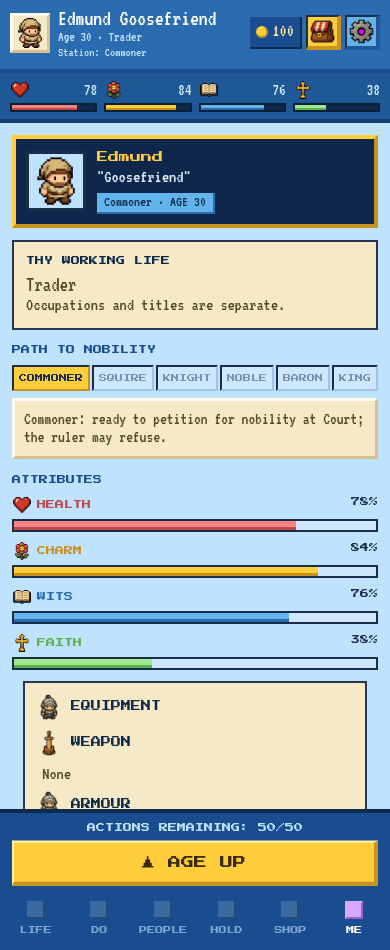
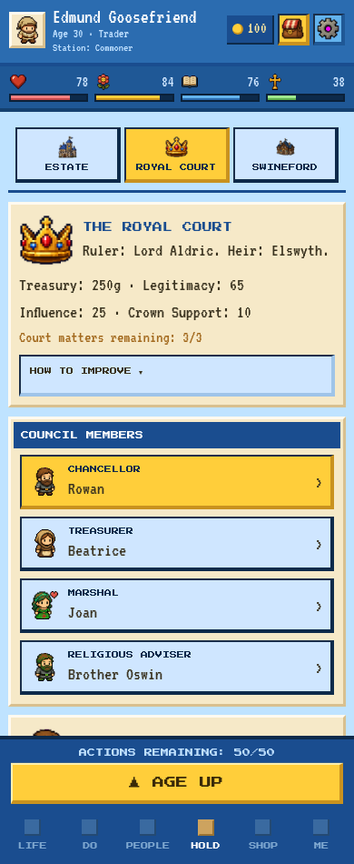

# Clean Me profile and Royal Court

Implemented on `v5` using `a29b44f` as the visual reference and `09fdeec` as the gameplay reference. Reviewed 5 November 2026.

Me is a character profile again: identity, working life, status tiles and one hint, attributes, skills/equipment, traits/reputation, and biography. Court has a compact overview with optional prose-only help. The underlying title, career, petition, succession, mortality, naming, ambition and save systems are preserved.

## Exact changed components

| File | Change |
| --- | --- |
| `src/components/tabs/MeTab.tsx` | Restored the earlier section order, parchment styling and horizontal status/access tiles. Replaced the dashboard with one compact hint. Retained attributes, equipment, traits, biography and optional nickname presentation. No ambition, progression checklist, promotion button or cross-tab navigation controls. Tiles scroll horizontally on narrow screens and size to their labels under enlarged text. |
| `src/components/tabs/AdvancementPanel.tsx` | Removed the unused oversized dashboard component. All shared requirement selectors, action handlers and progression modules remain. |
| `src/components/tabs/CourtPanel.tsx` | Replaced overview paragraphs with Treasury/Legitimacy and Influence/Crown Support values. Help starts collapsed and contains three short paragraphs. The council roster, selected office, political actions, detailed petition/title requirements, royal decisions, succession and records retain their existing workflow. |
| `src/screens/GameScreen.tsx` | Removed navigation wiring used exclusively by the retired Me dashboard. Existing Do → Court entry, remembered Holding section, Life-only ambition and scrolling Holding selectors remain. |
| `src/state/viewModel.ts` | Added pure `selectProgressionHint`, using existing barony/nobility/military requirements and actual royal succession. Status tiles retain Prince/Princess/Royal Kin/Royal Claimant labels where justified. No rank percentage returns. |

No engine rules, game-state types, save schema, persistence fields, costs, cooldowns, purchases, rewards, qualifications or RNG functions were changed. The only interactive Me tiles are the existing locked Premium tiles, which retain their access callback.

## Contextual hints

The complete fixture outputs are in [progression-hints.json](progression-hints.json). Examples derived from actual state:

| Profile | Example |
| --- | --- |
| Commoner with sufficient influence/support | “Commoner: ready to petition for nobility at Court; the ruler may refuse.” |
| Commoner without sufficient influence/support | “Commoner: gain influence 15+ and Crown support 5+; petition for nobility at Court.” |
| Squire lacking training | “Squire: complete martial training in Do → Practice to pursue knighthood.” |
| Knight with sufficient political qualifications | “Knight: ready to petition for nobility at Court; the ruler may refuse.” |
| Noble ready to buy | “Noble: seek a barony at Court; the patent costs 90g.” |
| Noble with Charm 72 | “Noble: a barony needs Charm 84 (now 72). Seek it at Court.” |
| Royal child, second in the real order | “Prince: 2nd in succession; the designated heir has priority at Court.” |
| Royal Kin without a claim | “Royal Kin: no eligible claim. Review the succession at Court.” |
| Baron | “Baron: the Crown requires a recognised claim. Review succession at Court.” |
| Monarch | “Monarch: protect your legitimacy and secure the succession at Court.” |

Tests also cover age, reserve money, service standing, missing martial occupation, Pro access, Princess, disinheritance, designation and changes to claim order. The helper prioritises a single relevant route or blocker. It is not a checklist, promise of appointment or continuous rank ladder.

At 390px the representative hint occupies two lines; at narrower widths or enlarged text it wraps naturally without truncation. Reading either screen and opening/closing help do not change state or draw RNG.

## Court help

The compact overview displays the actual ruler, heir, treasury, legitimacy, influence, Crown support and remaining court matters. Court professional standing remains in career/petition qualifications rather than in the overview.

**How to Improve starts collapsed.** Opening it displays only:

- Political influence: patronage, advice, new household alliances and investigations.
- Crown support: patronage and advice.
- Legitimacy: the ruler's authority and the danger of a weakened mandate.

There are **zero action buttons, links, input fields or duplicated controls inside the help content**, verified by both React tests and browser DOM checks at all requested widths. The existing disclosure control only changes local visibility. Numerical rewards and detailed eligibility remain with the existing mechanics and selected-action workflow.

## Automated validation

- **Full Jest: 107 suites, 1,064 tests passed.** Includes existing title/barony recovery, royal succession, political opposition, save/reload, dynasty, family, naming, death and ambition regressions. [Full result](jest-results.txt).
- **Final targeted UI/progression pass: 32 tests passed**, including the final tile-sizing adjustment. [Result](targeted-results.txt).
- **TypeScript: passed.** Includes the added fixture script. [Result](typescript-results.txt).
- **Production Expo exports: web, iOS and Android passed.** These are JavaScript/assets exports, not signed native packages. [Result](production-export-results.txt).
- **70-life deterministic cohort, seed 950100: byte-for-byte identical to the latest gameplay baseline.** All 70 lives complete; 194 reload checkpoints, no mismatches, integrity failures or stalls. Both reports have SHA-256 `cea03dfc4587b517e369d7ade7bf8a6ded9073599e3d6e10e4075dbf2974eb3f`. [Comparison](cohort-comparison.json), [run output](cohort-results.txt), [unchanged full cohort](../progression-usability/cohort.json).
- **Browser comparisons:** five viewport/text configurations each against original `a29b44f`, the expanded `09fdeec` UI, and the restored UI, plus eight restored-profile scenarios. Widths 280, 320, 390 and 768; enlarged text at 280. No page errors. [Original reference](original-browser.json), [expanded before](expanded-before-browser.json), [restored after](after-browser.json).

The browser also submits a real office petition for one action/one court matter without changing occupation, and buys a barony entirely through the existing Court workflow: 350g → 260g, rank 3 → 4, one action and one court matter. That purchase fixture has no active ambition so the price check is isolated from separate ambition rewards. Existing tests continue to verify off-Life ambition completion.

At 390px, Me's scroll content is approximately 1,135px, compared with 3,151px for the expanded dashboard and 1,283px in the original reference. The collapsed Court overview is approximately 226px, compared with 430px in the expanded version. Original Court was approximately 164px; the restored card additionally includes Crown Support and the optional help control. Pixel fonts, colours, parchment and borders retain their existing styles.

The original reference still contains its old ambition presentation and false rank percentage. Those are visible only in reference screenshots and were deliberately not restored. The retained Life-only ambition and non-sticky Holding selectors also provide more content height than the original reference.

## Screenshots

All comparisons use matching deterministic saves and 950px viewport height. Image prefixes are `original` (`a29b44f`), `expanded-before` (`09fdeec`) and `after` (restored UI).

| View at 390px | Original reference | Expanded before | Restored |
| --- | --- | --- | --- |
| Me, top | [Original](original-me-top-390.png) | [Before](expanded-before-me-top-390.png) | [After](after-me-top-390.png) |
| Me, attributes | [Original](original-me-attributes-390.png) | [Before](expanded-before-me-attributes-390.png) | [After](after-me-attributes-390.png) |
| Me, lower profile | [Original](original-me-lower-390.png) | [Before](expanded-before-me-lower-390.png) | [After](after-me-lower-390.png) |
| Court / help collapsed | [Original](original-court-collapsed-390.png) | [Before](expanded-before-court-collapsed-390.png) | [After](after-court-collapsed-390.png) |
| Help expanded | Not present in original | [Before](expanded-before-court-help-390.png) | [After](after-court-help-390.png) |
| Chancellor | [Original](original-chancellor-390.png) | [Before](expanded-before-chancellor-390.png) | [After](after-chancellor-390.png) |
| Petition for Office | [Original](original-petition-390.png) | [Before](expanded-before-petition-390.png) | [After](after-petition-390.png) |

Each comparison is also captured with `-280`, `-320`, `-768` and `-280-large` suffixes in this directory. Additional profile images show Squire, Knight, Noble, Prince, Royal Kin, Baron, Monarch and locked Premium tiles.





**Device limits:** Chromium width and enlarged-text checks passed. No physical iOS/Android device or native emulator was available; hardware safe areas and OS font/keyboard behaviour were not tested on a device. Existing safe-area/layout tests remain green.

## Reproduction

```sh
npm test -- --runInBand
npm run typecheck
tsx scripts/createCleanProfileUiFixtures.ts
tsx scripts/auditNarrative.ts --lives=70 --seed=950100 --output=/tmp/clean-profile-cohort.json
EXPO_NO_TELEMETRY=1 EXPO_OFFLINE=1 CI=1 node node_modules/expo/bin/cli export --platform all --max-workers 2 --output-dir /tmp/fate-clean-profile-after
# Serve each frozen/current export locally, then run:
PLAYWRIGHT_MODULE=/path/to/playwright CLEAN_UI_URL=http://127.0.0.1:8112 node scripts/verifyCleanProfileUi.cjs
# Reference runs use CLEAN_UI_VARIANT=original or expanded-before with their export URL.
```
