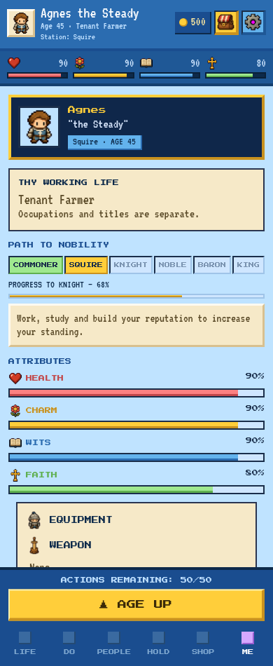
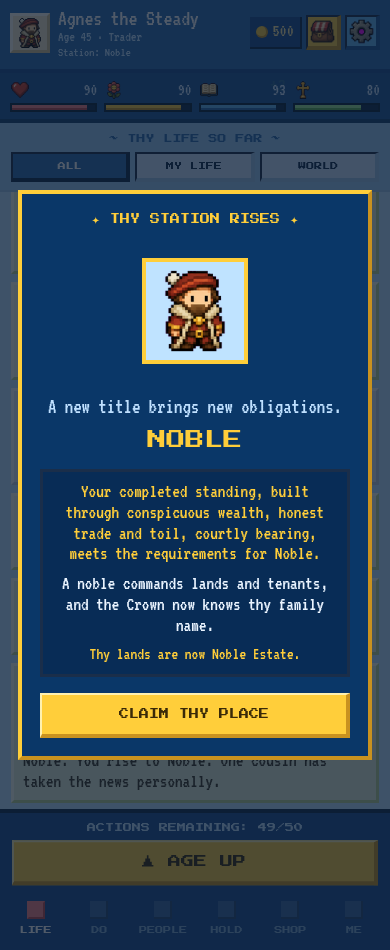

# Natural rank progression restored

Implemented on `v5` from `6fb6aa0`, reviewed 5 November 2026. The compact profile and existing pixel-art presentation remain in place.

## Rules

Ordinary progression is now **Commoner → Squire → Knight → Noble → Baron → Monarch**. Each successful ordinary promotion advances exactly one level and resets the existing `rankProgress` meter to zero. All careers can progress; Squire and Knight levels do not require military training, an army career, or a military honour.

| Next level | Progress | Age | Gold held (not spent) | Stats | Other condition |
| --- | --- | --- | --- | --- | --- |
| Squire | 100 | 12 | — | Wits 48 | — |
| Knight | 100 | 15 | — | Wits 64, Charm 56 | — |
| Noble | 100 | 20 | 120g | Charm 72, Wits 58 | — |
| Baron | 100 | 30 | 260g | Charm 80, Wits 72 | Pro |
| Monarch, ordinary final step | 100 | 40 | 420g | Charm 90, Wits 85, Faith 60 | Pro and lawful access to the Crown |

Age/stat thresholds for the early ranks and Noble reuse the original ladder. Baron is attainable without an event: age 30 replaces the abandoned age-38 purchase gate, with demanding but reachable stats. There is **no 90g barony purchase**. Monetary qualifications are reserves, not payments.

`rankPromotionRequirements()` is shared by `canPromote()` and the profile guidance. Automatic checks run after the existing action diminishing returns settle, after story resolution and through the existing annual progression. A pending story or encounter resolves before a promotion is shown. Reading screens, loading a save or refreshing entitlements does not silently advance a rank. The legacy force flag cannot bypass qualifications, progress, Pro or Crown law.

The meter stays within 0–100. Reaching 100 banks the completed standing until outstanding qualifications are met; negative yearly standing or effects do not erase that completed meter. Subsequent valid play recognises one next level. New lives, heir control changes and explicit demotion retain their established separate reset rules.

## Existing standing and anti-spam

`standingContributions()` remains the yearly account: career performance, reputation, wealth, personal attributes, estate prosperity, faction relations, debts, imprisonment and criminal reputation. Every occupation now contributes steady-work standing; respected work, professional reputation and education also contribute. No new XP currency or second progression system was added.

Existing activity diminishing returns and the five-use yearly routine cap remain. Promotion checks occur after those adjustments so raw rewards cannot promote a player before their reduced amount is settled. Legacy event promotion flags no longer force a title midway through an effect packet. Tests cover replay, repeated activities and exact one-level increments.

## Court and military shortcuts

The existing event/action IDs remain save-compatible:

- `court_nobility_petition` now seeks recognition. Success adds up to 20 standing and its existing reputation benefit, rather than jumping Commoner → Noble. The recorded recognition is replay-safe for that character/year.
- `baron_land_grant` remains an optional household-service scene. Acceptance adds up to 25 standing and its existing stat/reputation rewards, without charging gold or directly granting Baron. The current labels and narration explain recognition. It is not needed to advance.
- Existing Court controls now say Request Noble Recognition / Baronial Recognition. Their action allowances, annual limits, political conditions and Pro checks remain. Royal recognition of an untitled NPC advances one level at most and rejects a same-year replay.
- Actual command-service knighthood remains a military achievement. It no longer changes the ordinary rank. Ordinary promotion does not manufacture military qualifications or honours.

A recognition reward can finish the meter and enable a normal promotion, but only from the immediately preceding rank and only after all ordinary gates are met. Existing Court help remains collapsed and prose-only.

## Crown safeguards

A full Baron meter does not overthrow a living ruler, even if the player has a strong claim or is the designated heir. The ordinary final step requires either already recognised authority or first place in lawful succession to a vacant/deceased ruler, as well as the ordinary qualifications and Pro.

Existing royal birth, inherited starting statuses, recognised claims, political Crown routes and exceptional royal inheritance remain in force. Those are distinct from ordinary rank rewards. Parentage, disinheritance, heir designation, claim priority and the single recognised ruler remain authoritative. In the simulations, only two lives reached Monarch through those existing systems; standing alone never seized the Crown.

## Saves and existing promotion presentation

No save-schema version, ownership field or progression currency was added. Existing Noble and Baron levels/titles remain earned. Legacy paid-but-ungranted barony recovery is retained for old authoritative purchase records; new recognition cannot replay that old purchase reward. Old overfilled meters are safely bounded to 100, preserving a completed next-rank meter rather than clearing it. Current Noble/Baron progress survives repeated normalisation without RNG draws or new grants.

Continuation now preserves an heir's already-earned higher rank and royal ancestry rather than replacing it with a lower parental inheritance or demoting an existing Baron when access expires. New inherited Premium grants still use the existing access rules. Pro is required to earn new Baron/Monarch levels; expiry does not confiscate already-earned levels.

The existing `PromotionScreen` and celebration/sound path are reused. Its early-rank descriptions now explain career-independent levels rather than inventing military training. The existing celebration hook establishes a baseline on hydration, so loading an earned title does not replay the popup. Genuine rank changes still open it once, while birth and heir continuation remain excluded.

## Simulated attainment

[Full deterministic cohort](cohort.json): 162 lives, six occupations, Merciful/Normal/Brutal, three play styles, three seeds per combination. 121 lives have Pro and 41 are free. The existing reducer, actual activity/estate/career effects, existing balanced event policy and encounter helper are used, with actual mortality and no invulnerability, forced ranks, money, stats or claims. Occupations are controlled cohort assignments at eighteen to compare career independence; this measures advancement after employment rather than success at applying for a job.

| Rank | Reached (all 162) | Mean age among achievers |
| --- | --- | --- |
| Squire | 162/162 (100.0%) | 14.5 |
| Knight | 160/162 (98.8%) | 24.7 |
| Noble | 130/162 (80.2%) | 33.2 |
| Baron | 85/162 (52.5%) | 41.8 |
| Monarch | 2/162 (1.2%) | 58.5 |

**Pro Baron rate: 85/121 (70.2%).** Free characters reached Noble but none earned Baron or Monarch. All 162 lives finished; 472 reload checkpoints preserved rank, meter and RNG, and final world-integrity checks passed. These are outcomes for the documented simulation controllers, not forecasts for every player.

| Occupation | Noble reached / lives | Baron reached / Pro lives |
| --- | --- | --- |
| tenant farmer | 23/27 | 15/19 |
| trader | 25/27 | 17/21 |
| cleric | 20/27 | 14/20 |
| copyist | 20/27 | 11/21 |
| guard | 19/27 | 13/19 |
| barber surgeon | 23/27 | 15/21 |

| Play style | Actions per year | Noble reached / lives | Baron reached / lives | Mean Baron age |
| --- | --- | --- | --- | --- |
| casual | 2 | 35/54 | 16/54 | 54.8 |
| balanced | 6 | 45/54 | 33/54 | 40.7 |
| focused | 10 | 50/54 | 36/54 | 37.1 |

The casual controller uses less of the available yearly allowance, so sustained achievement takes longer. Balanced/focused characters can reach Noble and Baron well within the simulated lifetimes. The existing scale and standing system were sufficient; no replacement progression economy was introduced.

## Verification

- **Full Jest:** 108 suites, 1,069 tests passed. Includes existing deterministic life/reload, three-generation dynasty, succession, career, court, family, naming, mortality, migration and entitlement checks. [Result](jest-results.txt).
- **Final progression/family/succession/celebration check:** 58 tests passed after the heir-preservation adjustment. [Result](save-family-edge-results.txt).
- **TypeScript:** passed. [Result](typescript-results.txt).
- **Expo production exports:** web, iOS and Android passed. JavaScript/assets exports, not signed native packages. [Result](production-export-results.txt).
- **Browser:** five before configurations and ten after scenarios, no page errors. 280/320/390/768px and 1.35× text at 280. The real action flow promotes a merchant from Knight to Noble, records exactly one level, resets the meter, uses the existing popup and reloads without replaying it. Age, Pro and Crown blockers and a farmer's true 68% meter are verified. [Before](before-browser.json), [after](after-browser.json).

Existing progression tests were updated to assert the restored ladder rather than the retired purchase/shortcut rules. Dedicated coverage verifies a farmer without military qualifications; merchant promotion; one-level transitions; retained 100 progress at blockers; anti-spam ordering; optional recognition; existing Noble/Baron saves; Royal ancestry; Crown protection; military honours; replay-safe NPC recognition; and an already-earned Baron heir after Pro expiry.

## Me screenshots

The existing rank tiles, profile sections, parchment, colours, fonts and buttons remain. Under the tiles, a small existing `StatBar` displays actual `rankProgress` with one short hint. No dashboard, new navigation, new promotion button, new modal or Me ambition was added.

| State | Evidence |
| --- | --- |
| Previous compact Me | [Before](before-farmer-me-390.png) |
| Farmer / Squire, 68% to Knight | [After](after-farmer-me-390.png) |
| Age blocker, progress complete | [Age 20 required](after-age-me-390.png) |
| Pro blocker, progress complete | [Baron requires Pro](after-pro-me-390.png) |
| Full Baron meter, Crown still political | [Recognised route required](after-crown-me-390.png) |
| Existing earned promotion popup | [Noble promotion](after-earned-promotion-390.png) |
| Saved new level and reset meter | [Reload](after-after-promotion-reload-390.png) |
| Enlarged text, narrow phone | [280px large text](after-farmer-me-280-large.png) |

Before/after profile and attribute captures are also provided at 280, 320 and tablet 768 widths.





**Device limits:** Width and enlarged-text tests use Chromium. No physical iOS/Android device or native emulator was available; OS keyboard, device safe-area and store-package installation checks remain unverified. Existing layout/safe-area tests pass.

## Changed files and reproduction

The exact file inventory is [changed-files.txt](changed-files.txt). Primary mechanics are in `pathProgression.ts`, `ranks.ts`, `progressionRequirements.ts` and the adapted title/Court effects. Integration changes only settle promotion at existing transaction boundaries, preserve existing ranks during load/continuation, and prevent hydration from replaying the existing celebration. The compact Me change is confined to its meter and pure selectors; the only Court presentation changes describe recognition accurately.

```sh
npm test -- --runInBand
npm run typecheck
tsx scripts/auditNaturalRanks.ts --reps=3 --output=/tmp/natural-ranks-cohort.json
tsx scripts/createNaturalRankUiFixtures.ts
EXPO_NO_TELEMETRY=1 EXPO_OFFLINE=1 CI=1 node node_modules/expo/bin/cli export --platform all --max-workers 2 --output-dir /tmp/fate-natural-ranks-after
# Serve the export locally, then:
PLAYWRIGHT_MODULE=/path/to/playwright NATURAL_UI_URL=http://127.0.0.1:8114 node scripts/verifyNaturalRankUi.cjs
```
